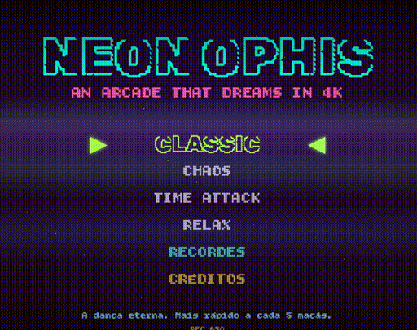

# NEON OPHIS

> *AN ARCADE THAT DREAMS IN 4K*

<p align="center">
  
</p>

Um Snake **moderno, neon e absurdamente satisfatório**. A nostalgia crocante de
um cartucho de Commodore 64 numa TV CRT, com o polimento indie de um *Downwell*
e o loop dopaminérgico de um slot-machine bem feito. Cada decisão de arquitetura
é traduzida de princípios reais do hardware C64 (VIC-II, SID, CIA) para web
moderna.

*Ophis* (ὄφις) é "cobra" em grego antigo.

**Stack:** TypeScript (strict) · Canvas 2D · Web Audio API · Vite · zero
dependências de runtime · zero assets externos.

---

## Destaques

- **Gráficos 100% procedurais** — cobra, comida, partículas, glow e trail
  desenhados em runtime no Canvas. Sem spritesheets de gameplay.
- **Áudio 100% sintetizado** — trilha e SFX gerados via Web Audio API no
  espírito do chip SID. A música escala em intensidade com score, combo e
  power-ups ativos. Sem nenhum arquivo `.wav`/`.mp3`.
- **Game feel acima de tudo** — fixed timestep a 60Hz com render interpolado,
  screen shake trauma-based, partículas em object pool, juice em cada ação.
- **4 modos:** Classic, Chaos, TimeAttack, Relax.
- **4 power-ups combináveis:** Rainbow, Ice, Fire, Magnet.
- **PWA instalável e offline** após uma única visita online.
- **Bilíngue PT/EN**, extensível a novos idiomas só largando um JSON.
- **High scores** com servidor próprio e fallback para `localStorage`.
- **Easter eggs** escondidos (Konami code, palavras secretas, scores mágicos…).
- Alvo de performance: **60 FPS sólido** num laptop modesto, bundle
  **< 100 KB gzipped**.

---

## Rodando localmente

Requisitos: **Node.js** (18+) e npm.

```bash
npm install        # instala devDependencies (vite, typescript, terser)
npm run dev        # dev-server Vite com HMR  → http://localhost:5173
npm run build      # typecheck + build de produção em dist/
npm run preview    # serve o build de produção localmente
npm run typecheck  # tsc --noEmit (TypeScript strict)
npm run assets     # regenera favicon / ícones PWA via ImageMagick
```

Não há dependências de runtime — o jogo roda só com o que o Vite empacota.

---

## Como jogar

| Entrada            | Ação                                             |
|--------------------|--------------------------------------------------|
| Setas / WASD       | Dirige a cobra (desktop)                          |
| Swipe              | Dirige a cobra (mobile)                            |
| Toque na tela      | Menu, pause, modais e nome no hi-score (mobile)   |

**Modos:**

- **Classic** — Snake clássico; acelera a cada 5 comidas; morre em parede e em si.
- **Chaos** — power-ups 3× mais frequentes + eventos aleatórios a cada 15s.
- **TimeAttack** — 60 segundos, maior score possível, atravessa paredes.
- **Relax** — sem morte (colisão só na ponta do rabo), trilha calma. Ideal para
  mostrar pra alguém.

Há easter eggs. Não vamos estragar a surpresa.

---

## Estrutura do projeto

```
src/
├── main.ts          # bootstrap: monta canvas, inicia o loop
├── engine/          # loop fixo + interpolação, state machine, RNG seedável
├── input/           # buffer de teclado, swipe, camada de toque
├── gameplay/        # cobra, comida, colisão, combo, modos, power-ups
├── render/          # pipeline em camadas, background, snake, food, HUD
├── fx/              # partículas, screenshake, glow, flash, texto flutuante
├── audio/           # synth SID-like, SFX, música procedural data-driven
├── ui/              # menu, splash, game over, scores, créditos, toggle idioma
├── i18n/            # interpretador + locales/{pt,en}.json
├── storage/         # high scores (cache + endpoint + fallback localStorage)
└── lab/             # Audio Lab — ferramenta DEV-ONLY, nunca vai pra produção

public/              # manifest, service worker, ícones, .htaccess (→ dist/)
scripts/             # build-assets.sh (ImageMagick) · build-fonts.sh
scores-server.js     # servidor de high scores para produção (Node puro)
vite.config.ts       # plugins: endpoint dev de scores, save do lab, guard do lab
```

A arquitetura completa — o "loop do raster", as camadas de render estilo
VIC-II, a síntese estilo SID, colisão em grid — está documentada em
**`CLAUDE.md`**, o blueprint do projeto.

---

## High scores e deploy

Arquitetura dual-endpoint (detalhes em `CLAUDE.md` §15):

- **Dev:** plugin do Vite intercepta `/__api/scores` e lê/grava
  `highscores.json` na raiz.
- **Produção (VPS + Apache):** `public/.htaccess` faz proxy de `__api/*` para
  `scores-server.js` (rodar via PM2). O `highscores.json` fica ao lado do
  servidor, **fora do `dist/`** — sobrevive a qualquer redeploy.
- **Fallback:** sem endpoint, cai para `localStorage` automaticamente.

PWA: `public/sw.js` é um service worker hand-rolled (zero deps). A API nunca é
cacheada; o shell é network-first; assets hasheados são cache-first. O SW
**nunca roda em dev** (guard em `main.ts`).

---

## Audio Lab (ferramenta interna)

`lab.html` + `src/lab/` é um mini-DAW interno para autorar e afinar a trilha
procedural ao vivo, ligado ao motor real de áudio. É **dev-only** e isolado em
três camadas independentes (build, plugin, runtime) — **nunca entra em
produção**. O único artefato que cruza para o jogo é
`src/audio/musicConfig.override.json` (dado de jogo, não código do lab). Ver
`CLAUDE.md` §22.

---

## Documentação do projeto

| Arquivo            | Conteúdo                                                       |
|--------------------|----------------------------------------------------------------|
| `CLAUDE.md`        | Blueprint e verdade do projeto: arquitetura, decisões fechadas |
| `DECISION_LOG.md`  | Log cronológico das decisões de design e implementação         |
| `HANDOFF.md`       | Estado atual, questões abertas, próximos passos                |
| `HISTORY.md`       | Histórico narrativo da evolução do projeto                     |

Ao mudar uma decisão, atualize o `CLAUDE.md` — ele é a fonte da verdade, não um
documento de inventar fatos novos em cima.

---

## Licença

Distribuído sob a **licença MIT** — ver [`LICENSE`](LICENSE).
Copyright (c) 2026 Adriano Franco.

O nome "NEON OPHIS", o logo, a identidade visual e a tagline **não** são
cobertos pela MIT — ver o aviso *Trademark & Branding* no fim do `LICENSE`.
Você pode forkar e redistribuir o código sob a MIT, mas não publicar um
derivado sob a marca NEON OPHIS sem permissão.

As fontes embarcadas são SIL OFL (Google Fonts) — licença própria, não cobertas
pela MIT. A marca e a tagline permanecem em inglês em todos os idiomas — são
identidade, não UI.
